# FOCUS — Storyboard

81 secondes · 16:9 · 1920 × 1080 · 60 i/s. Images extraites du film final (`tools/storyboard.py`).
Statut : **R** = interface réelle de FOCUS · **C** = visualisation conceptuelle (marquée à l'écran) · **M** = mise en scène / motion design.

Fil conducteur : la copie d'**Emma Leroy** (élève fictive des données de FOCUS, 8/20 au « Contrôle — Calcul littéral »),
son erreur de distributivité, la notion associée, le diagnostic de FOCUS, puis sa progression.
Motif visuel : **le point** — celui de « Accompagner. » puis celui de « … UN POINT DE DÉPART. » — devient le logo FOCUS.

## Acte I — Le problème (0:00 – 0:15.9)

| # | Image | Timecode | Plan | Son | Statut |
|---|---|---|---|---|---|
| 1 |  | 0:00.0 – 0:01.4 | Noir. | Léger bruit de stylo sur papier. | M |
| 2 | 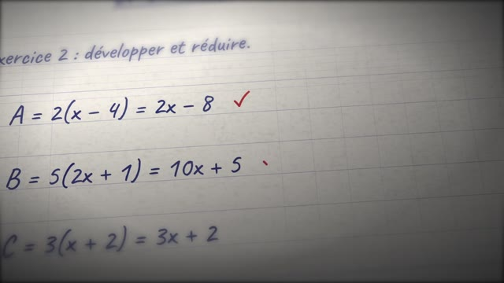 | 0:01.4 – 0:05.0 | Macro sur la copie d'Emma, lumière de fenêtre, faible profondeur de champ ; deux coches rouges. | Horloge de salle vide, coches. **VO** « Chaque jour, des millions de réponses sont corrigées. » | M |
| 3 | 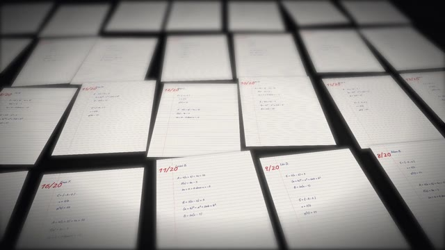 | 0:05.0 – 0:08.3 | Champ de copies à perte de vue ; les notes rouges apparaissent en cascade. | 13 traits de stylo. **VO** « Des notes sont attribuées. » | M |
| 4 | 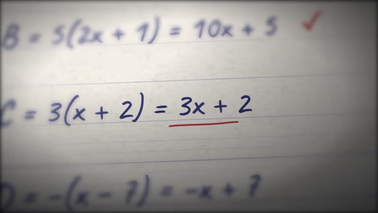 | 0:08.3 – 0:09.4 | Gros plan : C = 3(x + 2) = 3x + 2 ; « 3x + 2 » souligné en rouge. | Trait de stylo. **VO** « Mais une note… » | M |
| 5 | 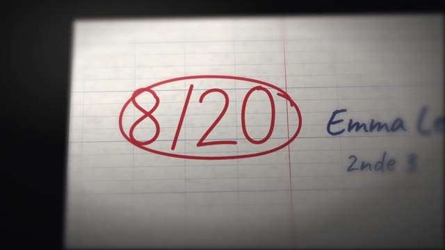 | 0:09.4 – 0:12.7 | La caméra remonte vers la marge : **8/20** écrit puis entouré. Silence court. | « …ne raconte jamais toute l'histoire. » | M |
| 6 | 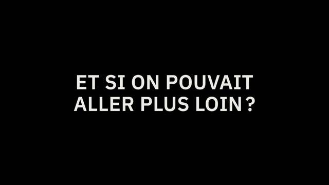 | 0:12.7 – 0:15.9 | Noir. Texte monumental centré : **ET SI ON POUVAIT / ALLER PLUS LOIN ?** | La musique commence (13.0 s) : octave grave au piano, nappe. | M |

## Acte II — La révélation (0:15.9 – 0:28.6)

| # | Image | Timecode | Plan | Son | Statut |
|---|---|---|---|---|---|
| 7 | 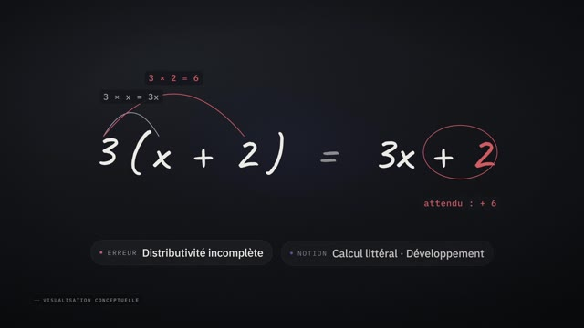 | 0:15.9 – 0:22.6 | L'erreur réécrite sur graphite ; les termes s'isolent ; arcs « 3 × x = 3x » et « 3 × 2 = 6 » ; « attendu : + 6 » ; étiquettes **Erreur : distributivité incomplète** · **Notion : Calcul littéral · Développement**. | **VO** « Et si l'intelligence artificielle aidait les enseignants à comprendre ce qui se cache derrière chaque erreur ? » Tics discrets synchronisés. | C |
| 8 | 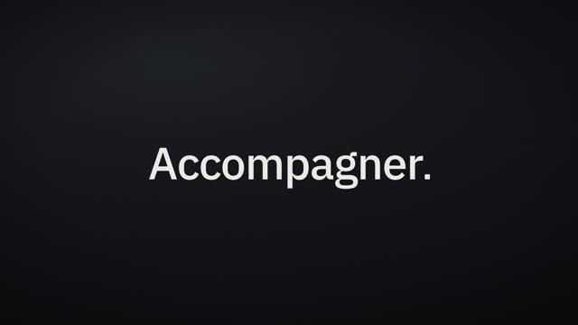 | 0:22.6 – 0:26.0 | **Comprendre. — Identifier. — Accompagner.** | Un accord de piano par mot. | M |
| 9 | 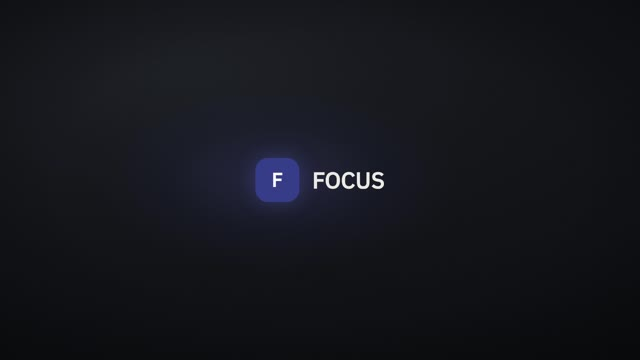 | 0:26.0 – 0:28.6 | Le point de « Accompagner. » glisse et devient le carré FOCUS ; le mot-symbole apparaît. | Impact grave + scintillement. **VO** « Voici FOCUS. » | R (logo) |

## Acte III — La technologie (0:28.6 – 0:53.8)

| # | Image | Timecode | Plan | Son | Statut |
|---|---|---|---|---|---|
| 10 | 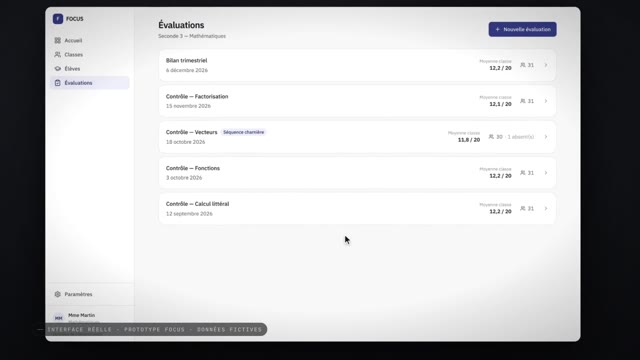 | 0:28.6 – 0:32.3 | Le logo s'arrime exactement au logo de la barre latérale ; la fenêtre FOCUS apparaît ; liste des évaluations ; clic sur « Contrôle — Calcul littéral ». | Pulsation, tics d'interface, clic. **VO** « Une plateforme conçue pour… » | R |
| 11 | 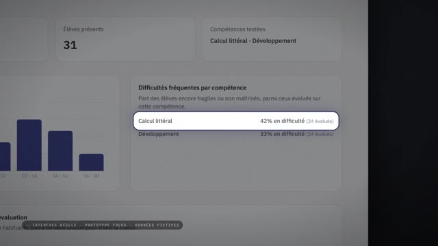 | 0:32.3 – 0:36.5 | La page d'évaluation se construit carte par carte (moyenne 12,2/20, distribution) ; zoom : **Calcul littéral — 42 % en difficulté**. | Souffle, tics, éclat. | R |
| 12 | 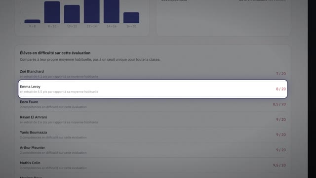 | 0:36.5 – 0:39.4 | Défilement ; **Emma Leroy — 8/20 — en retrait de 4.5 pts par rapport à sa moyenne habituelle** mise en lumière. | **VO** « Identifier les difficultés. » | R |
| 13 | 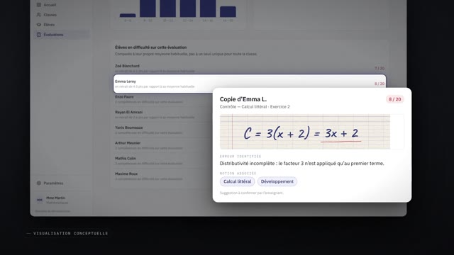 | 0:39.4 – 0:42.4 | Panneau « Copie d'Emma L. » : erreur soulignée, **Erreur identifiée**, **Notion associée : Calcul littéral · Développement**, « Suggestion à confirmer par l'enseignant ». | **VO** « Comprendre les notions qui posent problème. » | C |
| 14 | 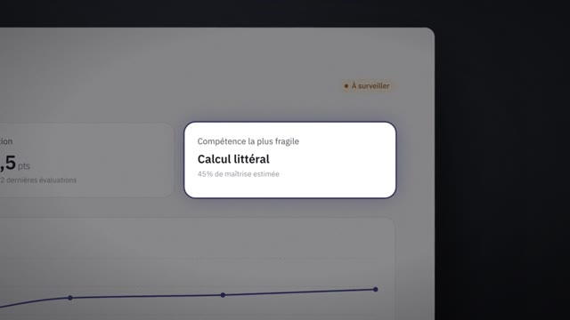 | 0:42.4 – 0:44.2 | Raccord sur la notion : fiche d'Emma, **Compétence la plus fragile : Calcul littéral — 45 %**. | Coupe. | R |
| 15 | 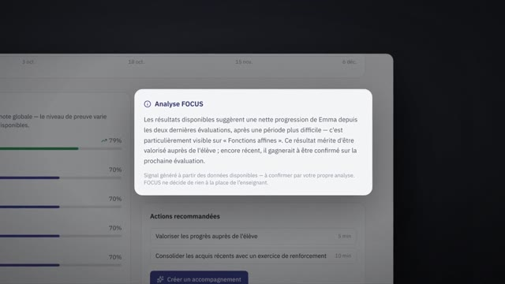 | 0:44.2 – 0:46.6 | **Analyse FOCUS** se détache de la page (diagnostic au conditionnel, avec réserve « à confirmer »). | **VO** « Et aider les enseignants à décider… | R |
| 16 | 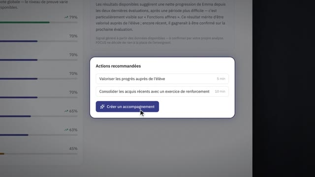 | 0:46.6 – 0:49.0 | **Actions recommandées** ; le pointeur rejoint « Créer un accompagnement ». | …comment accompagner chaque élève. » | R |
| 17 |  | 0:49.0 – 0:53.8 | Vue d'ensemble : tableau de bord de la classe (31 élèves, 21 / 7 / 3), Emma dans la liste d'attention ; la caméra recule. | Montée (nappe, cordes, souffle ascendant). | R |

## Acte IV — L'ambition (0:53.8 – 1:08.2)

| # | Image | Timecode | Plan | Son | Statut |
|---|---|---|---|---|---|
| 18 | 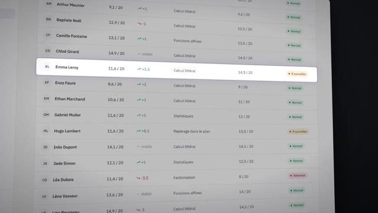 | 0:53.8 – 0:56.2 | Tableau de suivi : liste de classe en travelling incliné. | Groove complet. **VO** « Parce que derrière chaque erreur, il y a quelque chose à comprendre. » | R |
| 19 |  | 0:56.2 – 0:57.5 | « Accompagnement pour Emma » : préparer un exercice ciblé ; clic sur Confirmer. | Clic. | R (action simulée par le prototype) |
| 20 | 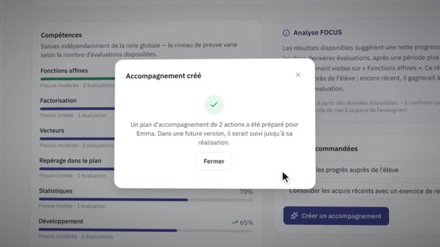 | 0:57.5 – 0:58.6 | « Accompagnement créé ». | Carillon discret. | R |
| 21 | 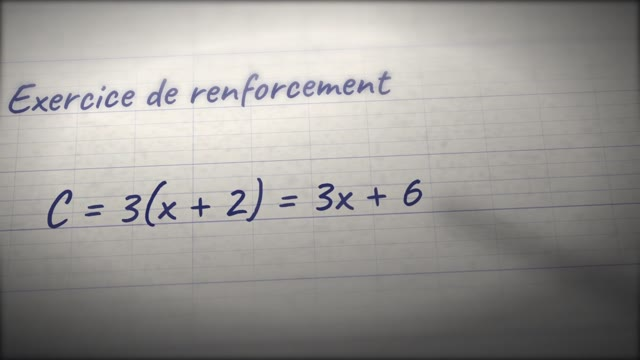 | 0:58.6 – 1:01.0 | Un élève travaille : « Exercice de renforcement — C = 3(x + 2) = 3x + 6 » s'écrit à la main. | Stylo. **VO** « Et derrière chaque élève, un potentiel à développer. » | M |
| 22 |  | 1:01.0 – 1:03.4 | Le logiciel sur un ordinateur portable (fiche d'Emma, courbe en progression). | Souffle montant. | M (objet) / R (écran) |
| 23 | 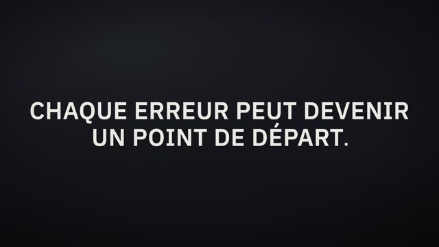 | 1:03.4 – 1:08.2 | **CHAQUE ERREUR PEUT DEVENIR / UN POINT DE DÉPART.** | Apogée musicale. | M |

## Acte V — Signature (1:08.2 – 1:21.0)

| # | Image | Timecode | Plan | Son | Statut |
|---|---|---|---|---|---|
| 24 | 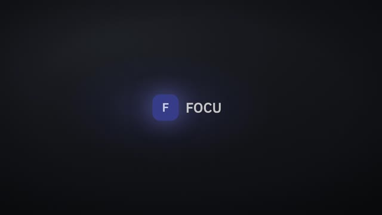 | 1:08.2 – 1:10.6 | Le texte s'efface, seul le point demeure ; il devient le carré FOCUS (floraison, balayage lumineux sobre). | La musique s'arrête et se résout en fa majeur ; souffle inversé, impact doux. | R (logo) |
| 25 | 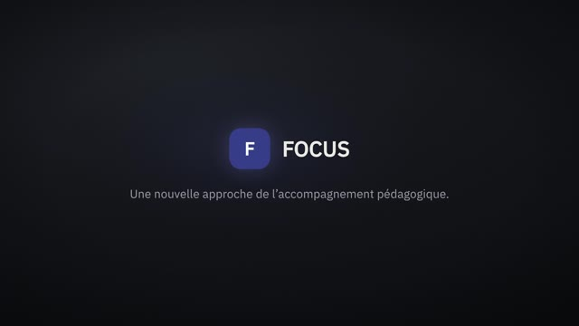 | 1:10.6 – 1:21.0 | **FOCUS** — « Une nouvelle approche de l'accompagnement pédagogique. » Poussée lente ; fondu au noir ; silence. | **VO** « FOCUS. Comprendre les erreurs. Accompagner les progrès. » Le piano répond entre les phrases. | R (logo) |
